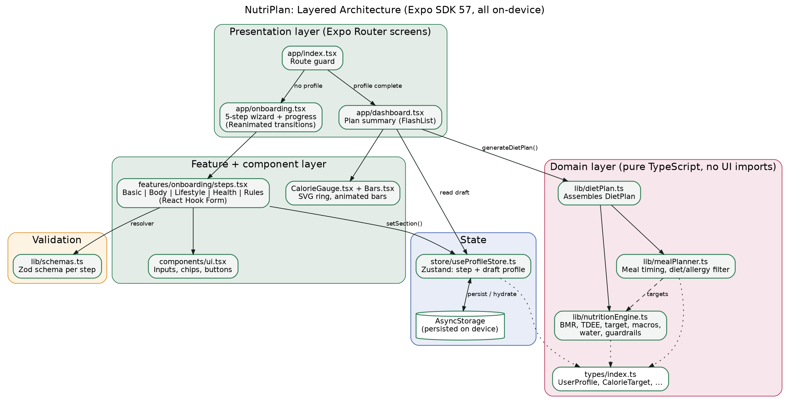
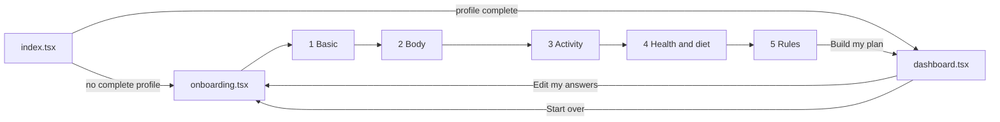
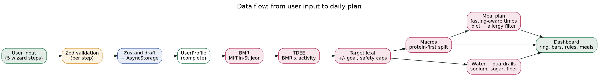
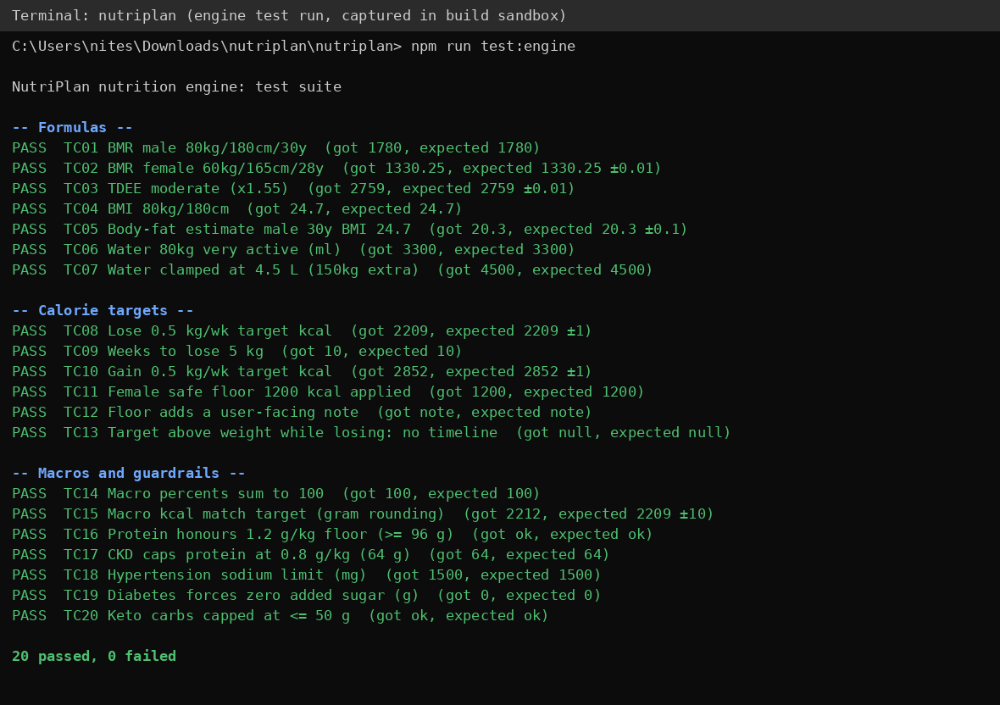

# NutriPlan: System Design Document

**Product:** Personalized Diet & Nutrition mobile app
**Stack:** React Native, Expo SDK 57, Expo Router, TypeScript (strict), NativeWind, Zustand, React Hook Form + Zod, Reanimated, FlashList
**Version:** 1.0 (on-device, offline-first)

---

## 1. Purpose and scope

NutriPlan collects a user's biometrics, lifestyle, health conditions and dietary rules, then calculates a daily calorie target, macro split, hydration target, safety guardrails and a meal plan.

**In scope (v1):** 6-stage workflow, on-device calculation, local persistence, one active profile.
**Out of scope (v1):** accounts/login, cloud sync, food logging, barcode scanning, a real food database, clinician review.

### Functional requirements

| ID | Requirement | Where implemented |
|----|-------------|-------------------|
| FR1 | Basic info: name, age, gender, biological sex, goal, pace, target weight | `BasicStep`, `basicSchema` |
| FR2 | Body: height, weight, waist, optional body fat, BMI | `BodyStep`, `calcBMI`, `estimateBodyFat` |
| FR3 | Activity level (5 levels mapped to multipliers) | `LifestyleStep`, `ACTIVITY_MULTIPLIER` |
| FR4 | Conditions, allergies, diet style | `HealthStep`, `healthSchema` |
| FR5 | Mandatory rules: protein floor, zero sugar, fasting, hydration, sodium | `RulesStep`, `buildGuardrails`, `calcWaterMl` |
| FR6 | BMR, TDEE, target, macros, meals | `nutritionEngine.ts`, `mealPlanner.ts` |

### Non-functional requirements

| Area | Target |
|------|--------|
| Privacy | All data stays on the device; no network calls |
| Offline | Fully functional with no connectivity |
| Performance | Plan generation is synchronous and O(1); dashboard list virtualized with FlashList |
| Safety | Hard limits on deficit, calorie floor and condition-specific caps (section 6) |
| Maintainability | Domain logic is pure TypeScript with no UI imports, so it is unit-testable in Node |
| Type safety | `strict` TypeScript plus Zod runtime validation on every form |

---

## 2. Architecture

The app has four layers. Dependencies point downward only.

| Layer | Responsibility | Files |
|-------|----------------|-------|
| Presentation | Screens and navigation (file-based routing) | `app/index.tsx`, `onboarding.tsx`, `dashboard.tsx` |
| Feature / components | Step forms and reusable inputs and charts | `features/onboarding/steps.tsx`, `components/*` |
| State and validation | Wizard progress and draft profile, schema checks | `store/useProfileStore.ts`, `lib/schemas.ts` |
| Domain | Calculations, meal logic, types. No React imports | `lib/nutritionEngine.ts`, `mealPlanner.ts`, `dietPlan.ts`, `types/` |

**Key decisions**

| Decision | Reason |
|----------|--------|
| Calculations on-device, no backend | Privacy for health data, offline use, zero hosting cost |
| Pure-function domain layer | Easy to test and to reuse in a future backend or web app |
| Zustand + `persist` | Small API, built-in AsyncStorage persistence, resume after app close |
| Plan is derived, not stored | `generateDietPlan(profile)` runs on render via `useMemo`, so the plan can never go stale against the profile |
| One Zod schema per step | Errors appear at the step where they happen, not at the end |
| Enums as `const` tuples in `types/` | One source of truth for TypeScript unions and Zod enums |

### Navigation flow

---

## 3. Data flow

1. The user completes a step; React Hook Form validates it with that step's Zod schema.
2. On success, `setSection()` saves the section into the Zustand draft, which is persisted to AsyncStorage.
3. When all five sections exist, `toProfile()` returns a complete `UserProfile`.
4. The dashboard calls `generateDietPlan(profile)`, which runs the engine and meal planner and returns a `DietPlan`.

---

## 4. Data model

| Type | Fields |
|------|--------|
| `BasicInfo` | name, age (18-80), gender, biologicalSex, goalType (`lose`/`maintain`/`gain_muscle`), weeklyRateKg, targetWeightKg |
| `BodyMetrics` | heightCm, weightKg, waistCm, bodyFatPct? |
| `LifestyleInfo` | activityLevel (`sedentary` ... `extra`) |
| `HealthProfile` | conditions[], allergies[], diet (`balanced`, `mediterranean`, `vegetarian`, `vegan`, `keto`, `paleo`) |
| `DietaryRules` | minProteinPerKg, zeroAddedSugar, fasting (`none`/`12:12`/`14:10`/`16:8`), windowStartHour |
| `UserProfile` | basic + body + lifestyle + health + rules |
| `CalorieTarget` | bmr, tdee, adjustment, targetKcal, weeklyChangeKg, weeksToGoal, macros, notes[] |
| `DietPlan` | bmi, bodyFat, waistToHeight, waterMl, target, guardrails[], meals[] |

Persisted storage: one AsyncStorage key, `nutriplan-profile`, containing `{ step, draft }` (versioned, `version: 1`, for future migrations).

---

## 5. Calculation engine

| Step | Formula |
|------|---------|
| BMR (Mifflin-St Jeor) | `10 x kg + 6.25 x cm - 5 x age + 5` (male) or `- 161` (female) |
| TDEE | `BMR x multiplier`: 1.2, 1.375, 1.55, 1.725, 1.9 |
| Goal adjustment | `weeklyRateKg x 7700 / 7` kcal/day; negative for loss, positive for gain |
| Target kcal | `TDEE + adjustment`, after safety caps |
| Protein | `max( min(goal g/kg x weight, 35% of kcal / 4), minProteinPerKg x weight )`; goal g/kg is 1.4 maintain, 1.8 lose or gain |
| Fat and carbs | Remaining kcal split by diet: fat share 0.30 vegan, 0.33 vegetarian, 0.35 balanced, 0.45 mediterranean/paleo, 0.90 keto. +0.08 for diabetes or PCOS (non-keto). Keto carbs capped at 50 g |
| Water | `35 ml x kg`, +250 ml moderate, +500 ml very/extra active, clamped to 1.5-4.5 L |
| Fiber | 14 g per 1,000 kcal |
| Body fat (if not entered) | Deurenberg: `1.2 x BMI + 0.23 x age - 10.8 x (male ? 1 : 0) - 5.4` |

### Worked example (matches tests TC01, TC03, TC08, TC09, TC15)

Male, 30 y, 80 kg, 180 cm, moderately active, lose 0.5 kg/week to 75 kg, balanced diet, protein floor 1.2 g/kg.

| Step | Result |
|------|--------|
| BMR | 800 + 1125 - 150 + 5 = **1,780 kcal** |
| TDEE | 1,780 x 1.55 = **2,759 kcal** |
| Adjustment | 0.5 x 7700 / 7 = **-550 kcal** (under the 25% cap of 690) |
| Target | **2,209 kcal/day** |
| Protein | min(1.8 x 80 = 144 g, 193 g cap) = **144 g** (above the 96 g floor) |
| Carbs / fat | **265 g / 64 g** (about 48% / 26%) |
| Timeline | 5 kg / 0.5 = **10 weeks** |

### Meal planner

- Each day has four slots with calorie shares: breakfast 25%, lunch 35%, snack 10%, dinner 30%. Macros are split by the same shares.
- Meal times are spread across the eating window (14 h with no fasting, 12, 10 or 8 h for fasting protocols) starting at the user's first-meal hour. Slot positions in the window: 0%, 35%, 60%, 90%. Example: no fasting, 7:00 AM start gives about 7:00 AM, 11:55 AM, 3:25 PM, 7:35 PM.
- Suggestions come from a built-in library of 30 meals, filtered by diet and excluded allergens. Celiac disease also excludes gluten. Up to 3 options per slot are shown. If none fit, the app says so and recommends a dietitian.

---

## 6. Safety rules (non-negotiable guardrails)

| Rule | Behaviour |
|------|-----------|
| Maximum deficit | Capped at 25% of TDEE; a note is shown when it applies |
| Calorie floor | 1,500 kcal (male) / 1,200 kcal (female); a note is shown when it applies |
| Protein floor | User-chosen g/kg (0.8-1.6) is never undercut |
| Chronic kidney disease | Protein capped at 0.8 g/kg (overrides the floor); sodium 2,000 mg; advice to confirm with a nephrologist |
| Hypertension | Sodium limit 1,500 mg (otherwise 2,300 mg) |
| Diabetes | Added sugar forced to 0 g |
| Celiac disease | Gluten-containing meals excluded; "strictly gluten-free" guardrail |
| Direction mismatch | If the target weight points the wrong way for the goal, no timeline is shown |
| Disclaimer | Dashboard states this is general guidance, not medical advice |

---

## 7. Screens

| Screen | Contents |
|--------|----------|
| Wizard (5 steps) | Animated progress bar, slide transitions, per-step validation, Back/Continue, progress survives app restarts |
| Dashboard | Calorie ring split by protein/carbs/fat, BMR to TDEE to target bars, macro bars, water/BMI/body fat/waist-to-height tiles, guardrail cards (red edge = critical), four meal cards with times and options, Edit and Start over buttons |

---

## 8. Testing

### 8.1 Automated unit tests (engine)

Run with `npm run test:engine` (Node 22+). **20 of 20 passed** in the build sandbox:

| Group | Cases | What is verified |
|-------|-------|------------------|
| Formulas | TC01-TC07 | BMR (male, female), TDEE, BMI, body-fat estimate, water, water clamp |
| Calorie targets | TC08-TC13 | Loss and gain targets, 1,200 kcal floor with note, weeks-to-goal, wrong-direction target |
| Macros and guardrails | TC14-TC20 | Percent total, calorie match, protein floor, CKD cap, hypertension sodium, diabetes sugar, keto carb cap |

### 8.2 Manual test plan (run on a device or emulator)

These have **not** been executed yet. Take a screenshot of each result for your submission.

| ID | Steps | Expected result | Screenshot |
|----|-------|-----------------|------------|
| M01 | Launch on a fresh install | Wizard step 1 opens, progress shows "Step 1 of 6" | `m01-start.png` |
| M02 | Tap Continue on empty step 1 | Red messages under required fields, no navigation | `m02-validation.png` |
| M03 | Enter age 15 | "Age must be at least 18" | |
| M04 | Choose Maintain goal | Pace chips disappear | |
| M05 | Complete step 2 with 180 cm / 80 kg | Live line "Your BMI is 24.7" | `m05-bmi.png` |
| M06 | Complete all 5 steps with the TC08 profile | Dashboard shows 2,209 kcal, about 10 weeks | `m06-dashboard.png` |
| M07 | Select Diabetes + Hypertension | Guardrails show "Zero added sugar" and "Sodium under 1500 mg" | `m07-guardrails.png` |
| M08 | Select Vegan + Nuts and Soy allergies | Meal cards contain no soy or nut meals | `m08-meals.png` |
| M09 | Fasting 16:8, first meal 12:00 PM | Meal times fall between 12:00 PM and about 7:10 PM | `m09-fasting.png` |
| M10 | Female, 50 kg, lose 1 kg/week | 1,200 kcal with the "safe minimum" note | `m10-floor.png` |
| M11 | Close the app on step 3 and reopen | Wizard resumes on step 3 with earlier answers kept | |
| M12 | Dashboard, tap Start over | Returns to empty step 1 | |

### 8.3 Known gaps

- UI, navigation and meal planner have no automated tests yet. Suggested next step: Jest + React Native Testing Library, with `mealPlanner` allergy-filter tests first.
- The meal library is small and not nutritionally analysed per item; per-meal macros are targets, not measured values.

---

## 9. Limitations and future work

| Area | Future work |
|------|-------------|
| Food data | Integrate a real food database (USDA FoodData Central or similar) and generate meals to hit macro targets |
| Tracking | Daily food and water logging, weight history charts |
| Accounts | Optional cloud backup with end-to-end encryption |
| Clinical safety | Dietitian-reviewed rules for each condition; pregnancy, minors and eating-disorder screening |
| Quality | Jest and Detox end-to-end tests, CI with `tsc` and lint |
| Localization | Units (lb, ft/in), translations, regional foods |

*This app provides general nutrition guidance and is not a substitute for medical advice.*
